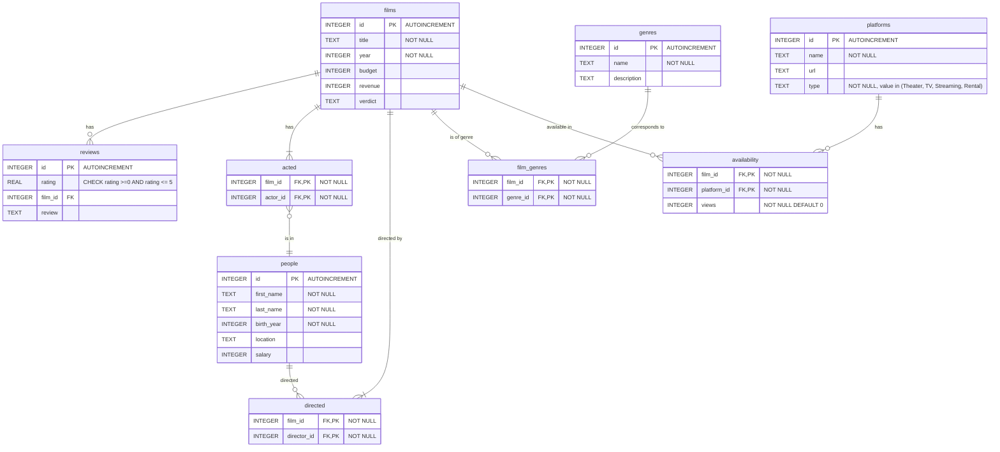

# Design Document

**By LENIN V J NAIR**

Video overview: https://youtu.be/wz5DESxW1Hc

## Scope

### Purpose

This database (`films.db`) handles details of movies and lets you track details such as the director, actors, revenue, budget, success status, reviews and ratings, and platforms where the film is available to watch.

The scope of the database includes most aspects of a movie. Things such as crew members of the movie, details of the production house, etc., are out of scope.

## Functional Requirements

### Usage of the database

A user should be able to query the database for various movie-related information, such as the year of release, director of the movie, actors present in the movie, its aggregate reviews and ratings, how many views the film has on a particular platform, which platforms the movie is available on, etc.

Information such as the plot of the movie, who plays which role, production house of the movie, format the movie is available in, etc., are not something the database currently stores.

## Representation

### Entities

The database has 9 tables, out of which 5 are primary tables and 4 are junction tables. Let's look at each table in detail.

#### films

The `films` table includes the following:

- `id` **(INTEGER, PRIMARY KEY, AUTOINCREMENT)**: The auto-incrementing primary ID of the movie.

- `title` **(TEXT, NOT NULL)**: Includes the name of the movie; it cannot be NULL.

- `year` **(INTEGER, NOT NULL)**: The year in which the movie was released.

- `budget` **(INTEGER)**: The budget of the movie.

- `revenue` **(INTEGER)**: The revenue the movie generated.

- `verdict` **(TEXT, CHECK)**: The success status of the movie. It should be one of the given values (`'Blockbuster', 'Super hit', 'Hit', 'Average', 'Flop', 'Disaster'`). `TEXT` is used because the values are descriptive labels, while the `CHECK` constraint restricts the column to the defined values.

#### people

The `people` table includes the following columns:

- `id` **(INTEGER, PRIMARY KEY, AUTOINCREMENT)**: The auto-incrementing primary ID of the person.

- `first_name` **(TEXT, NOT NULL)**: The first name of the person.

- `last_name` **(TEXT, NOT NULL)**: The last name of the person.

- `birth_year` **(INTEGER, NOT NULL)**: The year in which the person was born.

- `location` **(TEXT)**: The location associated with the person.

- `salary` **(INTEGER)**: The last-drawn salary of the person, if available.

#### genres

The `genres` table includes the following columns:

- `id` **(INTEGER, PRIMARY KEY, AUTOINCREMENT)**: The auto-incrementing primary ID of the genre.

- `name` **(TEXT, NOT NULL)**: The name representing the genre, for instance, `'Crime'`, `'Documentary'`, etc.

- `description` **(TEXT)**: A brief description of the genre. Can be NULL.

#### platforms

The `platforms` table includes the following columns:

- `id` **(INTEGER, PRIMARY KEY, AUTOINCREMENT)**: The auto-incrementing primary ID of the platform.

- `name` **(TEXT, NOT NULL)**: The name of the platform (`'Netflix'`, `'HBO'`, etc.).

- `url` **(TEXT)**: The URL of the platform.

- `type` **(TEXT, NOT NULL, CHECK)**: The platform type. It identifies whether it's a theater, streaming platform, TV channel, or rental service. The `CHECK` constraint restricts it to `'Theater'`, `'Streaming'`, `'TV'`, or `'Rental'`.

#### reviews

The `reviews` table includes the following columns. It includes individual ratings given by the audience, but doesn't track anything other than the rating and corresponding text review. Therefore, one film can have thousands of reviews.

- `id` **(INTEGER, PRIMARY KEY, AUTOINCREMENT)**: The auto-incrementing primary ID of the review.

- `rating` **(REAL, NOT NULL, CHECK)**: The rating (0–5) given to the film by the user. `REAL` is used because ratings can contain fractional values such as 4.5. The `CHECK` constraint ensures that the rating remains between 0 and 5.

- `film_id` **(INTEGER, NOT NULL, FOREIGN KEY)**: The foreign key ID of the film that the rating is for.

- `review` **(TEXT)**: A detailed review of the film. Can be NULL in case of reviews with only a rating.

#### directed

This is the junction table between `people` and `films` to track who directed which film.

- `film_id` **(INTEGER, NOT NULL, FOREIGN KEY, PRIMARY KEY)**: Tracks the foreign key `id` from `films`.

- `director_id` **(INTEGER, NOT NULL, FOREIGN KEY, PRIMARY KEY)**: Tracks the foreign key `id` from `people` corresponding to the director of the film.

In order to avoid duplicates, the primary key is a composite of `film_id` and `director_id`.

#### acted

This is the junction table between `people` and `films` to track who acted in which film.

- `film_id` **(INTEGER, NOT NULL, FOREIGN KEY, PRIMARY KEY)**: Tracks the foreign key `id` from `films`.

- `actor_id` **(INTEGER, NOT NULL, FOREIGN KEY, PRIMARY KEY)**: Tracks the foreign key `id` from `people` corresponding to the person who acted in the film.

In order to avoid duplicates, the primary key is a composite of `film_id` and `actor_id`.

#### film_genres

This is the junction table between `genres` and `films` to track the genres of films.

- `film_id` **(INTEGER, NOT NULL, FOREIGN KEY, PRIMARY KEY)**: Tracks the foreign key `id` from `films`.

- `genre_id` **(INTEGER, NOT NULL, FOREIGN KEY, PRIMARY KEY)**: Tracks the foreign key `id` from `genres` corresponding to which genres the film belongs to.

In order to avoid duplicates, the primary key is a composite of `film_id` and `genre_id`.

#### availability

This is the junction table between `platforms` and `films` to track the availability of films.

- `film_id` **(INTEGER, NOT NULL, FOREIGN KEY, PRIMARY KEY)**: Tracks the foreign key `id` from `films`.

- `platform_id` **(INTEGER, NOT NULL, FOREIGN KEY, PRIMARY KEY)**: Tracks the foreign key `id` from `platforms` corresponding to whether the film is available on the platform.

- `views` **(INTEGER, NOT NULL, DEFAULT 0)**: Tracks the views the film has accumulated on the specific platform. It only tracks the latest aggregate views, so date-wise view data is not available.

To avoid duplicates, the primary key is a composite of `film_id` and `platform_id`.

### Relationships

Now, let's see the key relationships among the tables.

1. **Films**:

   - Must have one or more directors.

   - Must have one or more actors.

   - May be available in zero or more platforms for viewing.

   - Can have zero or more reviews.

   - May be in zero or more genres.

2. **People**:

   - Can act in zero or more movies.

   - Can direct zero or more movies.

3. **Reviews**:

   - Each review must correspond to one movie.

4. **Platforms**:

   - Can have zero or more movies.

5. **Genres**:

   - Correspond to zero or more movies.

## Optimizations

I've built 4 indices within the database to make querying faster.

- Movie titles index (`movie_titles_idx`): This indexes the movie titles, making it easy to find a movie by its title.

- People's name index (`names_idx`): This indexes people's names (both first name and last name), making  identifying people easy.

- Acted index (`acted_idx`): Makes faster cross-referencing of actors who acted in specific movies.

- Directed index (`directed_idx`): Makes it faster to query directors who directed movies.

The database has three views:

- `film_details`: This is a view that gives a detailed view of each film, including its director, actors, year of release, genre, verdict, etc. It can be queried to find specific movies or details of movies directed by specific people.

- `film_availability`: This view gives details of all the platforms in which a film is available.

- `highest_rating`: This view gives the highest rating achieved by a movie during its lifetime.

## Limitations

The database is based on SQLite3. So, it has all the limitations of not having an enterprise-grade database server. Examples include the inability to create stored procedures. The db is using mostly table queries and views to provide the data. Also, concurrent querying is not possible as SQLite doesn't support it.

The database only includes certain details about movies. It doesn't have any details about the story, plot, characters of each movie; the crew members; or detailed statistics around views or ticket sales. However, an aggregate view count of a movie is available in the `views` column in the `availability` table.

## Conclusion

The database can be further improved to enterprise-grade by implementing on MySQL or SQL Server and include additional tables for various other details. The database can then represent the entire movie industry very well.
